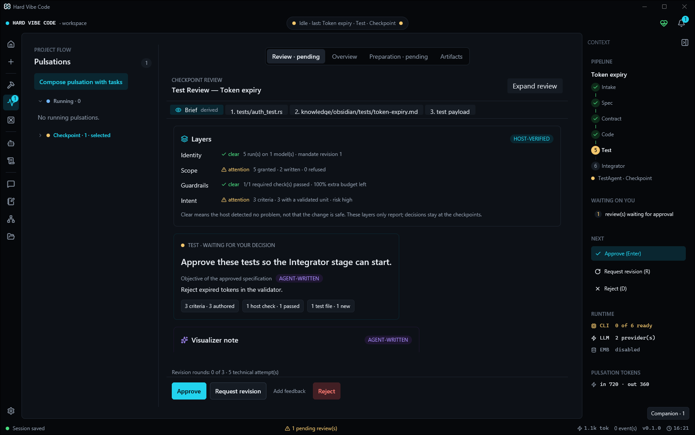
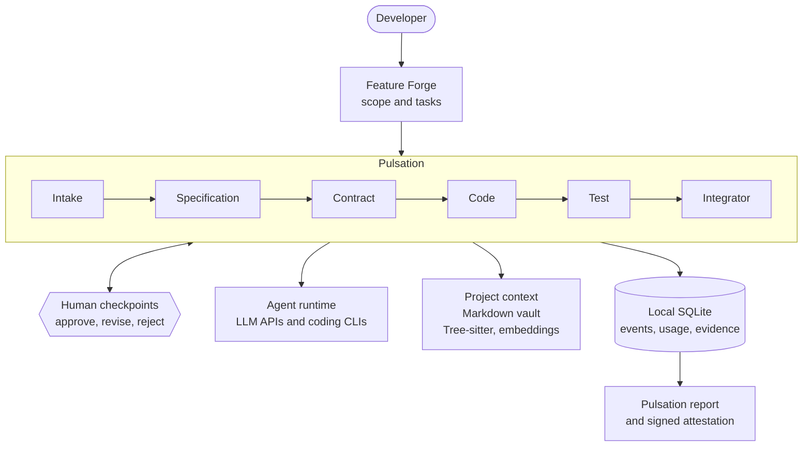
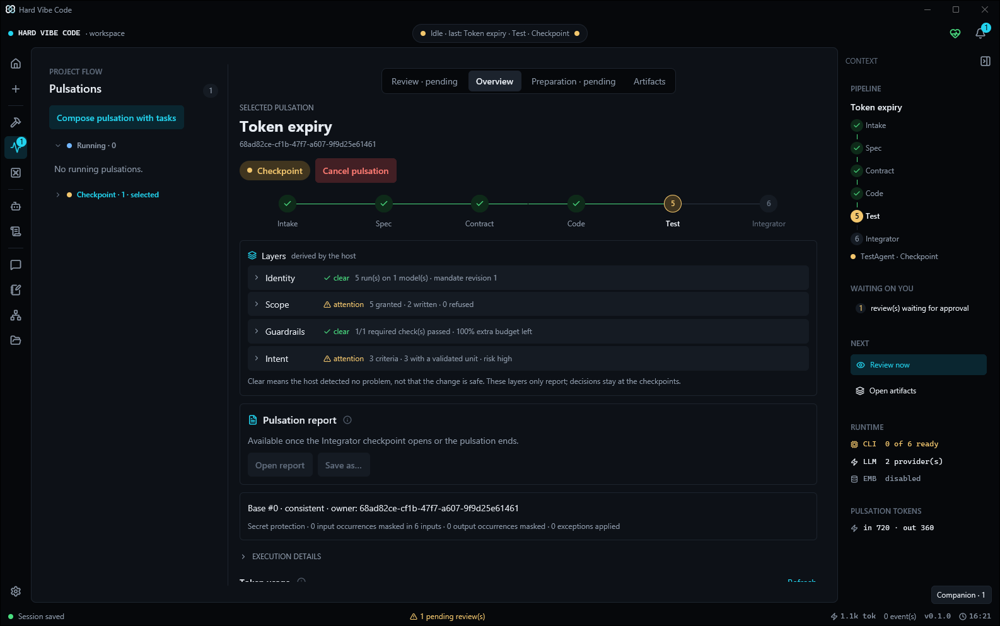
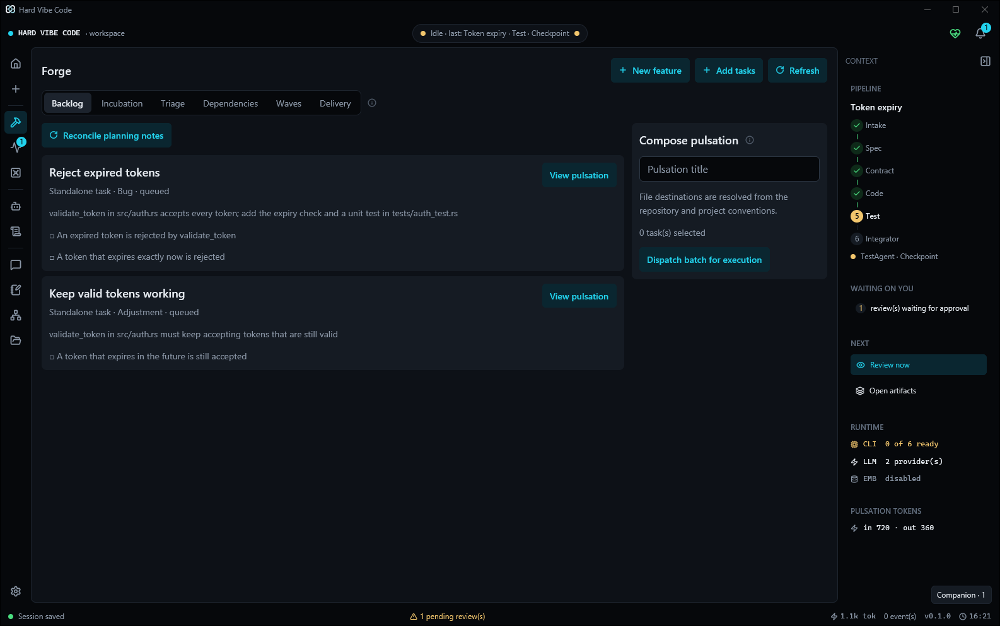
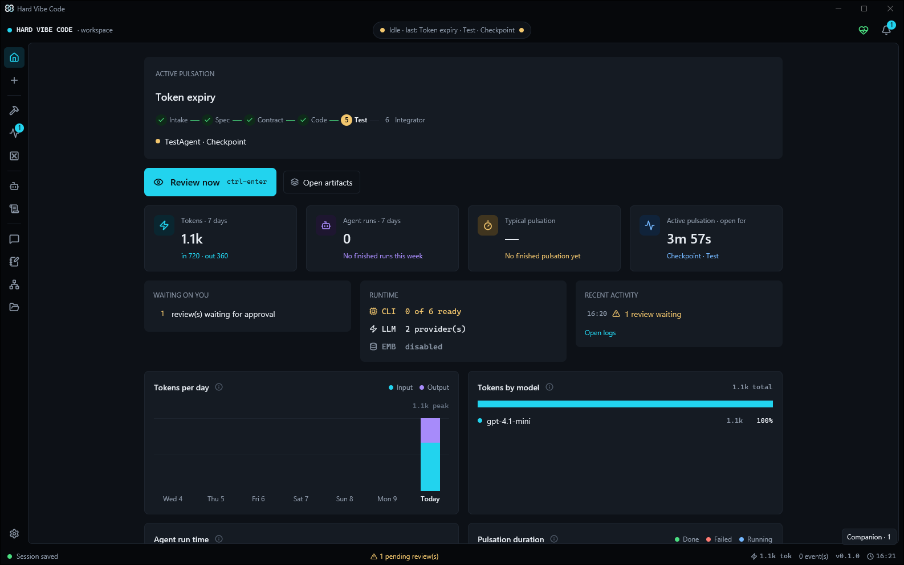
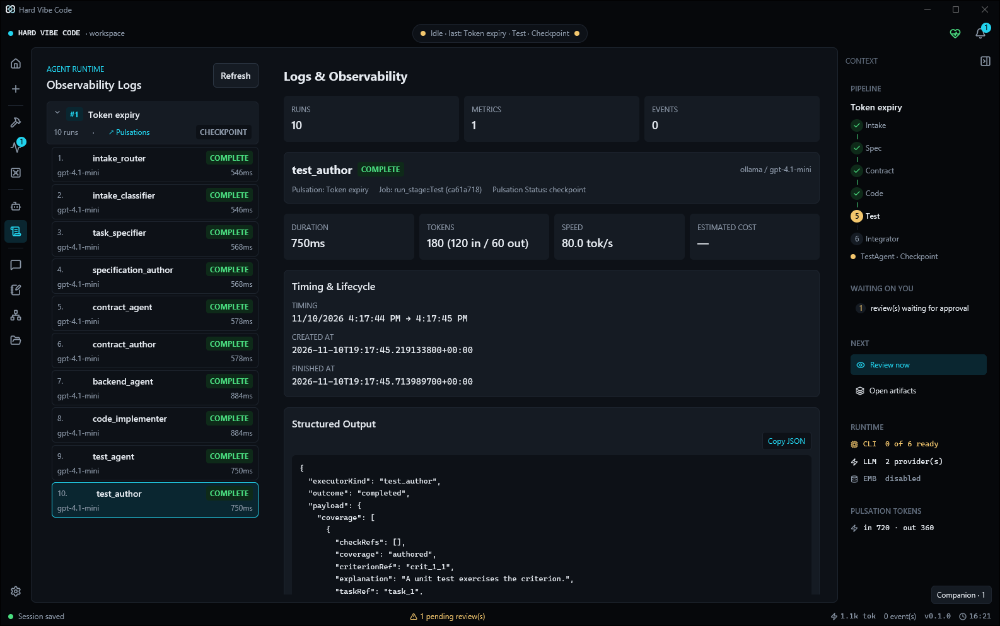
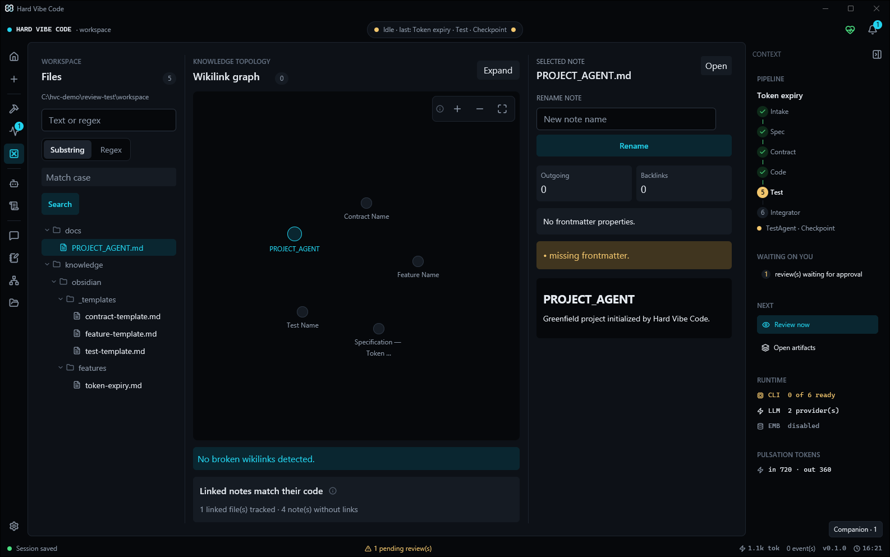
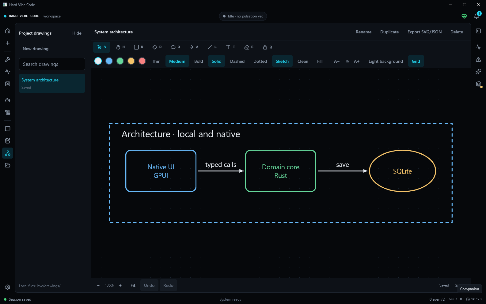

# Hard Vibe Code

A native Windows desktop application that runs AI coding agents through a
six-stage engineering pipeline, with a human decision at every checkpoint
that matters.

[](LICENSE)




<sub>A pulsation paused at its Test checkpoint. The brief is derived by the
host from validated records: criteria, the required check that ran, the new
test file and four trust layers. Nothing reaches the Integrator stage until
the developer approves, requests a revision or rejects.</sub>

## Why

AI coding agents are fast, but on their own they lose context, drift from
what was asked and report work as finished without evidence. Reviewing a
large generated change after the fact is slow and easy to get wrong.

Hard Vibe Code (HVC) keeps the speed and adds engineering discipline. Every
change runs as a **pulsation**: a fixed pipeline of six stages (Intake,
Specification, Contract, Code, Test and Integrator) carried out by agents
through LLM APIs or the official coding CLIs. Between stages, the developer
reviews a short brief and decides what happens next. The Rust host, not the
model, owns the state transitions, the file writes, the checks and the
evidence, so every claim in a brief is backed by records the host produced
itself.

## How it works



- **Feature Forge.** An idea becomes approved scope and backlog tasks through
  a conversation with a feature agent. Approval creates tasks; it never starts
  execution by itself.
- **Pulsations.** A pulsation freezes the selected task revisions and their
  approved context, then runs them through the six stages. Stage work is split
  into bounded units under a frozen plan, and a worker result never advances
  the pipeline on its own.
- **Human checkpoints.** Specification, Contract, Test and Integrator stop for
  review. The Review Brief summarizes criteria, host checks, files, risk and
  four trust layers (identity, scope, guardrails and intent). Supported stage
  failures park for Retry, a revision to a permitted stage or Abort.
- **Host-owned evidence.** Approving a Specification issues an execution
  mandate, an append-only and hash-chained record of what the later stages may
  write and which checks must run. Writes outside it are refused. When a
  pulsation ends, the host signs an in-toto statement in a DSSE envelope with
  an Ed25519 key kept in the operating system's credential store.
- **Agent runtime.** Each pipeline role runs through an API provider (OpenAI,
  Anthropic, Gemini, DeepSeek, Groq, Mistral, OpenRouter or a local Ollama) or
  an official CLI (Codex, Claude Code, Gemini CLI, OpenCode, Antigravity or a
  custom adapter). CLI processes run with argument arrays, reduced
  environments, deadlines, bounded output, cancellation and secret redaction.
- **Project context.** A Markdown vault with a wikilink graph, bounded
  repository reads, Tree-sitter and local embeddings through Ollama. Context
  traces record what each agent actually received.
- **Companion.** A chat dock that knows the project's pulsations and pending
  decisions, notes captured by text or by local voice dictation (Whisper or
  Nemotron on the CPU), and a native architecture canvas.
- **Local first.** One native Rust process built on
  [GPUI](https://crates.io/crates/gpui), the UI framework from the Zed
  editor. State lives in a local SQLite database and credentials in the
  operating system keyring.

## Screenshots

All screenshots use the demo data described in
[Try it with demo data](#try-it-with-demo-data).

| | |
|---|---|
|  |  |
| **Pulsation overview.** The six stages, the trust layers derived by the host and the pulsation report, available from the Integrator checkpoint. | **Feature Forge.** Backlog tasks with their acceptance criteria, and the panel that composes selected tasks into a pulsation. |
|  |  |
| **Home.** The active pulsation, what is waiting on you, the runtime state and token usage. | **Logs.** Every agent run with its model, duration, tokens and structured output. |
|  |  |
| **Vault.** The project's Markdown knowledge as a wikilink graph, with link and frontmatter checks. | **Canvas.** Native architecture drawings, saved with the project as JSON and SVG. |

## Status

- **Platform:** Windows 10 and 11, x64. The UI uses GPUI's Windows backend.
  The headless crates also build and test on Linux and macOS, with known gaps.
- **Maturity:** pre-release (0.1.0).
- **Distribution:** source only. There are no binary releases or installers
  yet; build from source. The current policy is recorded in
  [`quality/distribution-policy.json`](quality/distribution-policy.json).

## Getting started

### Requirements

- Windows 10 or 11, x64.
- [rustup](https://rustup.rs). `rust-toolchain.toml` pins Rust 1.98.0 with
  Clippy and rustfmt, and rustup installs it on the first `cargo` call.
- Visual Studio Build Tools 2022 with the "Desktop development with C++"
  workload and a recent Windows SDK.
- Optional: [Ollama](https://ollama.com) for local embeddings, and any of the
  supported coding CLIs, installed and signed in.

### Build and run

```powershell
git clone https://github.com/Nathan-dOS/HARD-VC.git
cd HARD-VC

# Keep development data apart from your real profile.
$env:HVC_DATA_DIR = "$PWD\target\dev-data"
cargo run --locked -p hvc-app
```

Without `HVC_DATA_DIR`, data is stored in
`%APPDATA%\com.hardvibecode.desktop\`. API keys are entered in Settings and
stored in the Windows Credential Manager; HVC does not read them from `.env`
files.

For an optimized build, `cargo build --locked --release -p hvc-app` produces
`target\release\hard-vibe-code.exe`, and
`powershell -ExecutionPolicy Bypass -File scripts/smoke-windows.ps1` runs the
Windows smoke test.

### Try it with demo data

The repository includes deterministic fixtures that run the pipeline against
a scripted local provider. They let you explore a paused pulsation without API
keys or internet access:

```powershell
cargo build --locked -p hvc-test-support --bin check_fixture
cargo run --locked -p hvc-test-support --example review_brief_fixture -- target\demo-review --stage test --visualizer

# Use the HVC_DATA_DIR value that the fixture prints.
$env:HVC_DATA_DIR = "<printed data directory>"
cargo run --locked -p hvc-app
```

The fixture refuses to reuse a directory, so pass a new one each time.
`--stage` also accepts `contract`, `integrator`, `failure`, `scope` and
`done`; without it, the pulsation stops at the Specification checkpoint. The
canvas example runs on its own with
`cargo run --locked -p hvc-ui --example canvas_preview`.

## Repository layout

| Path | Contents |
|---|---|
| `crates/hvc-app` | Entry point and composition root; builds `hard-vibe-code.exe` |
| `crates/hvc-ui` | Native GPUI views, review controls and design system |
| `crates/hvc-core` | Domain, SQLite migrations, workspace, provider routing and orchestration, with no GPUI dependency |
| `crates/hvc-terminal` | CLI runtime: adapters, discovery, process isolation and the plan-usage meter |
| `crates/hvc-contracts` | Shared execution, stage, timeout, usage and redaction types |
| `crates/hvc-editor` | Rope text model, selection, undo, diff, Markdown and Tree-sitter |
| `crates/hvc-voice` | Local dictation: pinned speech runtimes, microphone capture and push-to-talk |
| `crates/hvc-test-support` | Isolated harnesses, test doubles and the demo fixtures |
| `third_party/gpui` | Vendored GPUI 0.2.2 and its [patch ledger](third_party/gpui/HVC-PATCHES.md) |
| `docs/` | Architecture, testing guide and design summaries |
| `quality/` | Dated validation reports and the distribution policy |
| `parity/` | Traceability from the retired Tauri frontend tests to their Rust equivalents |
| `scripts/` | Quality gate, smoke test, supply-chain audits and boundary checks |

Built with Rust 1.98 (edition 2024), GPUI 0.2.2, Tokio, SQLite through
rusqlite with refinery migrations, ropey, Tree-sitter, pulldown-cmark, reqwest
with rustls, notify and keyring.

## Development

Run these before opening a pull request:

```powershell
cargo fmt --all -- --check
cargo clippy --workspace --all-targets --locked -- -D warnings
cargo test-core   # or the alias for the area you changed
```

The aliases live in `.cargo/config.toml`. All of them keep the lockfile
(`--locked`) and run at most two tests at a time per binary:

| Command | Scope |
|---|---|
| `cargo test-ui` | UI |
| `cargo test-editor` | Editor and the UI that uses it |
| `cargo test-core` | Contracts, terminal, voice and core |
| `cargo test-support` | Harnesses, integration tests and the UI that uses them |
| `cargo test-all` | The whole workspace, including integration tests and doctests |
| `cargo test-headless` | Crates without GPUI; the Linux Docker harness runs this one |

`scripts/gate-stage7.ps1` is the full quality gate: formatting, Clippy,
workspace tests, a release build, the Windows smoke test and the license,
source and advisory audits. On GitHub Actions, formatting runs on every pull
request and the dependency audits run when dependencies change; the Windows
suites and the Linux harness run on manual dispatch. The
[testing guide](docs/testing.md) covers the CI split, the Docker harness and
how to investigate a single area.

To check a voice dictation install without a microphone:

```powershell
cargo run --locked -p hvc-voice --example voice_probe -- "$env:LOCALAPPDATA\com.hardvibecode.desktop\voice" whisper-large-v3-turbo
# Append a mono, 16-bit, 16 kHz WAV path to transcribe it. Use `nemotron` for the other backend.
```

## Documentation

- [Architecture](docs/architecture.md)
- [Testing guide](docs/testing.md)
- [Design decisions](docs/adr/README.md), summarized from the architecture records
- [Pulsation attestations](docs/attestation.md)
- [Review policy and the Integrator's inputs](docs/review-policy.md)
- [Secret sanitization](docs/secret-sanitization.md)
- [Cargo candidate validation](docs/cargo-validation.md)
- [Native architecture canvas](docs/native-canvas.md) and [Canvas AI authoring](docs/canvas-ai-authoring.md)
- [Validation reports](quality/README.md), dated records of what was checked and what remains open

## Performance

When the earlier Tauri frontend was retired, a short comparison measured the
time to a visible window with SQLite ready: a P50 of 247.5 ms for the native
GPUI build against 528.7 ms for Tauri, 53.2% less. Idle memory had a P50 of
140.4 MiB against 361.3 MiB, 61.1% less. These numbers describe one machine
and the methodology recorded in the [Stage 7 report](quality/stage7-report.md);
they are not general guarantees.

## Contributing

Bug fixes, tests, documentation, new CLI adapters and Linux or macOS
portability of the headless crates are welcome. Read
[CONTRIBUTING.md](CONTRIBUTING.md) before opening a pull request. AI-assisted
contributions are welcome under the human-in-the-loop rules described there.

Report security issues privately, as described in [SECURITY.md](SECURITY.md).

## License

Copyright (C) 2026 Nathan de Oliveira dos Santos

Hard Vibe Code is free software: you can redistribute it and/or modify it
under the terms of the GNU General Public License as published by the Free
Software Foundation, either version 3 of the License, or (at your option) any
later version. It is distributed in the hope that it will be useful, but
WITHOUT ANY WARRANTY; without even the implied warranty of MERCHANTABILITY or
FITNESS FOR A PARTICULAR PURPOSE. See [LICENSE](LICENSE) for the full text.

Third-party code keeps its own license: the vendored GPUI in
[`third_party/gpui`](third_party/gpui/LICENSE-APACHE) is Apache-2.0, and the
[Lucide icons](crates/hvc-ui/assets/icons/LICENSE-lucide.txt) are ISC.
