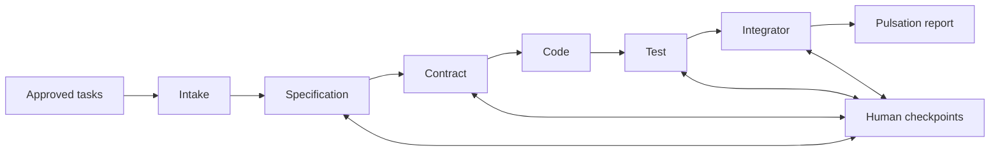

# Architecture

Hard Vibe Code is a local Windows x64 desktop application built with Rust and
GPUI. The UI and domain services share one process and use typed Rust calls.
The terminal and shared-contract boundaries were separated in ADR-030 (2026-10-23).

| Crate | Responsibility |
|---|---|
| [hvc-app](../crates/hvc-app/src/main.rs) | Application startup and composition root |
| [hvc-contracts](../crates/hvc-contracts/src/lib.rs) | Shared execution, stage, timeout, usage and redaction values |
| [hvc-terminal](../crates/hvc-terminal/src/lib.rs) | CLI services, repository, adapters, process isolation, discovery and subscription quota |
| [hvc-core](../crates/hvc-core/src/lib.rs) | Domain, migrations, workspace, provider routing, orchestration and terminal host integration |
| [hvc-ui](../crates/hvc-ui/src/lib.rs) | Native views, review controls and design system |
| [hvc-editor](../crates/hvc-editor/src/lib.rs) | Text model, selection, undo, diff and Markdown support |
| [hvc-test-support](../crates/hvc-test-support/src/lib.rs) | Isolated harnesses, doubles and integration fixtures |

`hvc-core` does not depend on GPUI. The vendored GPUI package and its local
changes are documented in [HVC-PATCHES.md](../third_party/gpui/HVC-PATCHES.md).

The dependency direction is `hvc-core -> hvc-terminal -> hvc-contracts`, with
core also using contracts directly. Terminal has no dependency on core, UI or
the integration harness, including development dependencies. Shared values are
reexported through their established core paths. Core service facades retain
the existing constructors and adapt application requests to the CLI subsystem.
The [boundary check](../scripts/check-crate-boundaries.ps1) validates the Cargo
graph, including optional features and build/development edges.

Core supplies the terminal's host capabilities: authorized input preparation,
workspace projection, output sanitization and global usage recording. A candidate
input proof is not authority: core checks its concrete type and exact prompt
before returning a validated projection. Privileged range authorization remains
private to core. SQLite migrations remain core-owned; the terminal repository
uses that same migrated database. See [ADR-030](adr/030-terminal-boundary.md).

## Execution and review

Feature Forge refines scope and produces approved backlog tasks. Starting a
pulsation freezes the selected task revisions and their approved context.
The pipeline retains six stages:

The Rust host owns identifiers, input revisions, hashes, permitted writes,
state transitions and publication. Pipeline v4 divides suitable stages into
bounded work units under a frozen plan; a worker result does not independently
advance the pipeline. See [ADR-022](adr/022-stage-composition.md).

Review uses complete persisted documents. The derived Brief reads validated
typed payloads under the same checkpoint identity and state version. It does
not replace the persisted documents or the host's approval checks. Confirm and
Flag help compose revision feedback; the Visualizer's note is consultative.
See [ADR-027](adr/README.md#adr-027-review-brief-and-report).

Supported stage failures can park at a checkpoint for the actions offered by
the host: Retry, revision to a permitted stage, or Abort. Shared budgets and
generation checks continue to apply. See [ADR-021](adr/README.md#adr-021-stage-failure-checkpoints).

Companion notes sit outside the pipeline. A capture is stored before the Notes
Scribe structures it; the Scribe has no tools or repository and changes only
its own note through a host-validated contract. Notes never create tasks,
features or pulsations. See [ADR-029](adr/README.md#adr-029-companion-notes)
and [companion_notes](../crates/hvc-core/src/companion_notes/mod.rs).

## Storage and context

SQLite stores domain state, migrations, events, checkpoints and usage records.
`HVC_DATA_DIR` isolates development and test data; the default database location
is `%APPDATA%\com.hardvibecode.desktop\hard-vibe-code.db`. Provider credentials
are managed through Settings and the operating system keyring.

Project context combines Markdown notes, repository reads, Tree-sitter and
local embeddings through Ollama. Context traces distinguish delivered sources
from cited sources. Learning runs in the background after terminality; graph
changes require human approval and host publication checks.
See [ADR-008](adr/README.md#adr-008-context-telemetry).

## Process and publication boundaries

CLI adapters use executable paths and argument arrays, bounded output,
deadlines, cancellation and secret redaction. Host-controlled project checks
use a disposable writable candidate of a trusted project; this is not an
operating system security sandbox. Model-authored claims do not prove that a
check ran. Accepted execution evidence must come from host receipts.

Publication validates expected content and current ownership before applying
changes. Multi-file publication uses durable, replayable intent rather than
claiming one atomic filesystem transaction.

Start with the [design summaries](adr/README.md), [test guide](testing.md) and
[dated validation reports](../quality/README.md). The reports distinguish
implemented behavior, executed checks and remaining work.
