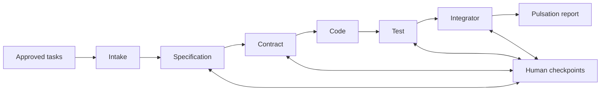

# Architecture

Hard Vibe Code is a local Windows x64 desktop application built with Rust and
GPUI. The UI and domain services share one process and use typed Rust calls.
The terminal and shared-contract boundaries were separated in ADR-031 (2026-10-23).

| Crate | Responsibility |
|---|---|
| [hvc-app](../crates/hvc-app/src/main.rs) | Application startup and composition root |
| [hvc-contracts](../crates/hvc-contracts/src/lib.rs) | Shared execution, stage, timeout, usage and redaction values |
| [hvc-terminal](../crates/hvc-terminal/src/lib.rs) | CLI services, repository, adapters, process isolation, discovery and subscription quota |
| [hvc-voice](../crates/hvc-voice/src/lib.rs) | Pinned speech runtime install, microphone capture, global push-to-talk and earcons |
| [hvc-core](../crates/hvc-core/src/lib.rs) | Domain, migrations, workspace, provider routing, orchestration and terminal host integration |
| [hvc-ui](../crates/hvc-ui/src/lib.rs) | Native views, review controls and design system |
| [hvc-editor](../crates/hvc-editor/src/lib.rs) | Text model, selection, undo, diff and Markdown support |
| [hvc-test-support](../crates/hvc-test-support/src/lib.rs) | Isolated harnesses, doubles and integration fixtures |

`hvc-core` does not depend on GPUI. The vendored GPUI package and its local
changes are documented in [HVC-PATCHES.md](../third_party/gpui/HVC-PATCHES.md).

The dependency direction is `hvc-core -> hvc-terminal -> hvc-contracts`, with
core also using contracts directly. Terminal has no dependency on core, UI or
the integration harness, including development dependencies. Shared values are
reexported through their established core paths. Core service facades retain
the existing constructors and adapt application requests to the CLI subsystem.
Core also depends on `hvc-voice`, a leaf with no local dependency at all. The
[boundary check](../scripts/check-crate-boundaries.ps1) validates the Cargo
graph, including optional features and build/development edges.

Core supplies the terminal's host capabilities: authorized input preparation,
workspace projection, output sanitization and global usage recording. A candidate
input proof is not authority: core checks its concrete type and exact prompt
before returning a validated projection. Privileged range authorization remains
private to core. SQLite migrations remain core-owned; the terminal repository
uses that same migrated database. See [ADR-031](adr/031-terminal-boundary.md).

## Execution and review

Feature Forge refines scope and produces approved backlog tasks. Starting a
pulsation freezes the selected task revisions and their approved context.
The pipeline retains six stages:

The Rust host owns identifiers, input revisions, hashes, permitted writes,
state transitions and publication. Pipeline v4 divides suitable stages into
bounded work units under a frozen plan; a worker result does not independently
advance the pipeline. See [ADR-022](adr/022-stage-composition.md).

Review uses complete persisted documents. The derived Brief reads validated
typed payloads under the same checkpoint identity and state version. It does
not replace the persisted documents or the host's approval checks. Confirm and
Flag help compose revision feedback; the Visualizer's note is consultative.
See [ADR-027](adr/README.md#adr-027-review-brief-and-report).

Supported stage failures can park at a checkpoint for the actions offered by
the host: Retry, revision to a permitted stage, or Abort. Shared budgets and
generation checks continue to apply. See [ADR-021](adr/README.md#adr-021-stage-failure-checkpoints).

Companion notes sit outside the pipeline. A capture is stored before the Notes
Scribe structures it; the Scribe has no tools or repository and changes only
its own note through a host-validated contract. Notes never create tasks,
features or pulsations. See [ADR-029](adr/README.md#adr-029-companion-notes)
and [companion_notes](../crates/hvc-core/src/companion_notes/mod.rs).

Companion Canvas also sits outside the pipeline. Its framework-independent scene,
geometry, validation and SVG exporter live in `companion_drawings`; GPUI owns input,
camera and gesture history. SQLite commits content plus durable mirror intentions;
a restricted writer materializes JSON/SVG under the project's `.hvc/drawings/`.
Project deletion shares the drawing service's project guard. See
[native canvas](native-canvas.md) for save, conflict and lifecycle behavior.

The published [Canvas AI authoring](canvas-ai-authoring.md) adds a separate
consent-bound job runner and V58 request/staging storage. A final-answer offer is
not permission. Native approval freezes the Companion target; publication commits
one new drawing and its ready receipt. Completion never navigates. Manual semantic
commands share core validation and preserve scene/history; no general repository
write tool is exposed. Source commit
[`e7dfe4e`](https://github.com/Nathan-dOS/HARD-VC/commit/e7dfe4e10691c2e7101839f89a0917d227fc4c9b)
passed the nine-check gate on its selected source tree, excluding unrelated local
voice changes. The [publication record](../quality/canvas-ai-publication-2026-10-29.md)
distinguishes that qualification from the earlier combined checkout and states
the physical/live-provider limits and unexposed optional document resolver.

Voice dictation feeds the same capture path. The core
[voice service](../crates/hvc-core/src/voice.rs) owns the settings, installs the
pinned runtime and model on request and registers the global push-to-talk only
once both are ready. Settings retains Nemotron 3.5 ASR Streaming 0.6B with
NeMo-Speech.cpp 0.2.0 CPU and offers Whisper large-v3-turbo Q5_0 with
whisper.cpp 1.9.5 CPU. The maintainer's 2026-10-29 decision replaces the Python
Whisper medium backend with the native Whisper executable; Whisper dictation
requires no Python, PyTorch or resident service. Runtime archives and model
files are pinned by version or revision, size and SHA-256.

A held shortcut records 16 kHz mono audio in memory; on release the WAV is
written to a scratch file and transcribed by one short-lived process for the
selected backend. Whisper fixes Portuguese (`pt`) and transcription; Nemotron
retains automatic language detection. The scratch WAV is deleted after the
attempt, and a successful transcript is captured as a `voice` note in the open
project. The backend choice and push-to-talk preferences persist across
restarts. No resident speech server runs. Current qualification is recorded in
the [2026-10-29 Whisper report](../quality/whisper-cpp-validation-2026-10-29.md).

## Storage and context

SQLite stores domain state, migrations, events, checkpoints and usage records.
`HVC_DATA_DIR` isolates development and test data; the default database location
is `%APPDATA%\com.hardvibecode.desktop\hard-vibe-code.db`. Provider credentials
are managed through Settings and the operating system keyring.

Project context combines Markdown notes, repository reads, Tree-sitter and
local embeddings through Ollama. Context traces distinguish delivered sources
from cited sources. Learning runs in the background after terminality; graph
changes require human approval and host publication checks.
See [ADR-008](adr/README.md#adr-008-context-telemetry).

## Process and publication boundaries

CLI adapters use executable paths and argument arrays, bounded output,
deadlines, cancellation and secret redaction. Host-controlled project checks
use a disposable writable candidate of a trusted project; this is not an
operating system security sandbox. Model-authored claims do not prove that a
check ran. Accepted execution evidence must come from host receipts.

Publication validates expected content and current ownership before applying
changes. Multi-file publication uses durable, replayable intent rather than
claiming one atomic filesystem transaction.

Approving a pipeline v4 Specification issues an execution mandate: an
append-only, hash-chained record of the write envelope, executor policies,
transports, check profiles and frozen budget parameters that the later stages
run under. A stage write outside the mandate is refused at acceptance and again
at publication, and a changed transport or check profile parks the next stage
until it is restored. Every checkpoint decision records a receipt with the
digests it covered. A pure function then derives four trust layers from those
records (who ran, what could be and was written, which limits held, how the
approved criteria stand), each `clear`, `attention`, `issue`, `not_applicable`
or `unknown`; the detail reads them in the same transaction as the composed
execution, and they never decide anything. A Code or Test unit that must
change a delivered file it does not own reports `scope_insufficient` with the
file's ref; the host decides from the frozen plan and the mandate which files
it may be granted, and "Grant and retry" at the failure checkpoint issues a
`scope_grant` revision and runs the stage again, giving the unit those files
in its next plan. See [ADR-035](adr/035-execution-mandates.md).

When a pulsation ends, its terminal transition records a seal intent, and the
background lane later seals it: the host derives an in-toto statement from its
own rows (subjects are the applied files with their digests; the predicate
holds identifiers, digests, states and counters only), signs it in a DSSE
envelope with an Ed25519 key kept in the operating system's credential store,
and stores an immutable record. Verification checks the signature, re-derives
the statement from the current rows and hashes each subject in the workspace;
only the first two can disagree with the record. See
[ADR-036](adr/036-pulsation-attestation.md) and [attestations](attestation.md).

## Agent exchange

The host is the only router between agents, and it labels what it routes.
Every content item the host did not write reaches a model under one
`> provenance:` line outside its fence: the trust class (`host`, `human`,
`agent_output`, `tool_output` or `repository`), the producer, the unit and
attempt, the approval gates it passed and a digest of the body. The fence is
always longer than any backtick run in the body, so a forged line stays inside
it. One legend in each system prompt says that only host and human items may
instruct. The line reduces the weight of injected text; the snapshot, host
publication and read-only tools remain the controls that bound it.

Domain writes that other surfaces follow also append one item to a durable
exchange log in the same transaction: pulsation transitions and checkpoints,
stage executions and unit attempts, publications, CLI run states, finished
Companion answers, notes and drawings. Forge turns, documentation
reconciliation and canvas requests span several transactions, so they record
right after their last commit. Items reference their domain rows and never
copy content; an append with a stale execution fence writes nothing and
aborts the domain write. The UI follows the log by a
cursor: a doorbell checks the log every 250 ms and applies new items in order,
a gap or a lagged broadcast triggers a ranged re-read, and only a cursor too far
behind triggers a full reload. A gap in a terminal run's events re-reads just
the missing range.

A resumable manual CLI run keeps a per-file manifest of its snapshot and, for
small text files, the sanitized content it saw. An explicit session resume
after workspace edits starts a new snapshot, compares it with the parent's
manifest and tells the agent what changed, with sanitized hunks, before its
message; too many changes refuse the resume, and the launch refuses a snapshot
other than the one the notice described. The Companion records the digest of
each repository file it reads and warns, with paths only, when one changed
before a later turn.

When a pulsation ends, the background lane derives a digest of it from its
rows, without a model: intent, approved decisions, criteria, checkpoints,
stages, files, risk and attestation, each section with its provenance line.
The Companion's `search_pulsations` and `read_pulsation` tools search and read
those digests, scoped to the conversation's project.
See [ADR-037](adr/037-agent-exchange.md).

Start with the [design summaries](adr/README.md), [test guide](testing.md) and
[dated validation reports](../quality/README.md). The reports distinguish
implemented behavior, executed checks and remaining work.
