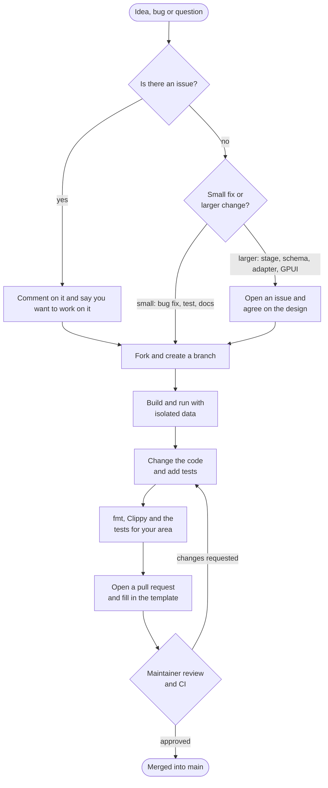

# How to contribute, step by step

This page shows the path of a contribution to Ikore, from the first
idea to the merge. [CONTRIBUTING.md](../CONTRIBUTING.md) holds the complete
rules; each step below links to the part that matters.



## 1. Start from an issue

Search the [issues](https://github.com/Nathan-dOS/Ikore/issues) first. If one
already describes your idea, say in a comment that you want to work on it, so
two people do not do the same work.

- **Small changes go straight to a pull request:** bug fixes, tests,
  documentation and local refactors.
- **Larger changes start with an issue:** a new pipeline stage, a change to the
  contract between stages, a migration or schema change, a new CLI backend or
  LLM provider, a heavy dependency, a change to the vendored GPUI or to the
  human checkpoint flow. Agreeing on the design first saves you from
  rewriting the work later.

Use the issue forms: **Bug report** or **Feature request**. Security problems
never go in a public issue; see [SECURITY.md](../SECURITY.md).

## 2. Fork, clone and branch

```bash
git clone https://github.com/<your-user>/Ikore.git
cd Ikore
git remote add upstream https://github.com/Nathan-dOS/Ikore.git
git switch -c fix/short-description
```

Branch prefixes: `feat/`, `fix/`, `docs/`, `refactor/`, `test/` and `ci/`
([CONTRIBUTING, section 4.1](../CONTRIBUTING.md#41-fork-clone-and-branch)).

On Windows, some validation reports under `quality/` have long paths. If Git
reports `Filename too long`, run `git config --global core.longpaths true` or
clone into a shorter folder such as `C:\src`.

## 3. Build and run with isolated data

On Windows 10 or 11 with [rustup](https://rustup.rs) and Visual Studio Build
Tools 2022 (C++ workload):

```powershell
$env:IKORE_DATA_DIR = "$PWD\target\dev-data"
cargo run --locked -p ikore-app
```

`IKORE_DATA_DIR` keeps your experiments away from your real profile. To explore
a paused pulsation without API keys, use the demo fixture described in the
[README](../README.md#try-it-with-demo-data). On Linux or macOS you can work on
the headless crates (`ikore-core`, `ikore-editor`, `ikore-test-support` and others),
natively or through Docker.

## 4. Change the code and add tests

- Keep the change small and focused on one problem.
- Respect the crate boundaries: `ikore-core` never depends on GPUI, and
  `ikore-test-support` is never used by production code.
- Add a test that fails without your change. Tests use isolated directories,
  an isolated keyring and no network.
- Write code, comments, identifiers and commit messages in English.
- Never include real keys, tokens, personal paths or private data. Use
  obviously synthetic values such as `fixture-secret-value`.

Details: [CONTRIBUTING, section 5](../CONTRIBUTING.md#5-architecture-and-quality-guidelines).

## 5. Run the checks

```powershell
cargo fmt --all -- --check
cargo clippy --workspace --all-targets --locked -- -D warnings
cargo test-core      # or test-ui, test-editor, test-support for your area
```

Run `cargo test-all` as well when you touch migrations, dependencies, stage
contracts or the CLI runtime. The [testing guide](testing.md) explains every
alias.

## 6. Commit and open the pull request

Use [Conventional Commits](https://www.conventionalcommits.org) with a scope:

```text
fix(terminals): classify synthetic Claude API errors as failures
```

Push your branch and open a pull request against `main`. The template asks
what changed and why, how to test it and which checks you ran. If an AI tool
wrote a relevant part of the change, say so: it helps the review and is never
a reason to reject the contribution
([CONTRIBUTING, section 6](../CONTRIBUTING.md#6-ai-assisted-contributions)).

## 7. Review and merge

- GitHub Actions checks formatting on every pull request and audits
  dependencies when they change. The maintainer runs the full Windows suites
  and the Linux harness on demand.
- The project has a single maintainer. A small pull request with a clear
  description and passing checks is reviewed faster.
- If changes are requested, push new commits to the same branch; the pull
  request updates by itself.
- After approval, the pull request is merged into `main`.

## Where to start

Good first contributions, all useful today:

- Make more of the headless test suite pass on Linux. Some CLI process and
  terminal tests are still Windows-specific.
- Translate the Portuguese comments and script messages that remain in the
  code. Test fixtures that are intentionally in Portuguese stay as they are.
- Improve the documentation in `docs/` or add a missing test.
- Add or improve a CLI adapter, after opening an issue to agree on the design.

## License of contributions

Ikore is licensed under the GNU General Public License v3.0 or later.
By opening a pull request, you agree that your contribution is distributed
under the same license. You keep the copyright of what you wrote. There is no
separate contributor agreement to sign.

All participation follows the [Code of Conduct](../CODE_OF_CONDUCT.md).
